<div align="center">

  

# Slimefun Knowledge · Drake edition

**A machine-built knowledge base of Slimefun and every addon that runs on DrakesCraft — plus tools that turn it into guides, GUI renderers and tutorial videos.**

<p>
  
  
  
  
</p>

</div>

> ### 🏰 Join the official DrakesCraft community
> * 🎮 **Server IP**: `mc.drakescraft.cl` *(Java 1.21.11 & Bedrock, port 25565)*
> * 💬 **Discord**: [discord.gg/drakescraft](https://discord.gg/rv3vtXZTk7)
> * 🌐 **Website & guides**: [web.drakescraft.cl](https://web.drakescraft.cl)

## Why this exists

Slimefun has thousands of items and a steep learning curve, and DrakesCraft adds dozens of addons on top. This project lets any AI (Claude, Codex,
Antigravity, OpenCode…) **understand** how it all works without a human explaining it in game, and generates guides, dialogues and videos from
facts instead of guesses.

## How it learns

| Layer | What | How |
|---|---|---|
| **Facts** | items, recipes, energy, researches, machine recipes, book categories | a throwaway Paper server loads Slimefun + the addons and a small plugin exports the **real registry** (`dump-plugin/`) |
| **Graph** | what produces what, production chains (dust → ingot → alloy → armor…) | computed from the facts (`tools/build_docs.py`) |
| **Mechanics** | how each system really works | agents read the source code and write cited pages (`tools/study_queue.py`, validated by `tools/verify.py`) |
| **Content** | guides, GUI renders, narrated videos | generated only from the layers above |

Nothing is invented: if the dump or the code does not say it, it is not in a script.

## What is inside

| Path | Purpose |
|---|---|
| `dump-plugin/` | Paper plugin that exports Slimefun's registry to JSON, then shuts the server down |
| `data/slimefun-dump.json.gz` | ~16,000 items from 64 addons · 440 researches · 270 book categories |
| `tools/kb.py` | query it: search, recipe, ingredient tree, who produces what, where it is used |
| `tools/build_docs.py` | one page per item, per-addon indexes, production flows (generated, not committed) |
| `tools/gui_guide.py` | rebuilds the Slimefun Guide book (all pages, locked categories, recipes) as data |
| `tools/roadmap.py` | learning order of the book's categories, computed from ingredient depth |
| `tools/diff_dumps.py` | "what changed on DrakesCraft" between two dumps |
| `knowledge/mechanics/` | agent-written, source-cited explanations (first one: ore processing and dust) |
| `video/` | Remotion project: narrated tutorials and the animated Guide GUI renderer |
| `docs/VIDEOS_PENDIENTES.md` | what exists, what is pending (next: Output Chest in the YouTube video) and in which order |
| `docs/VIDEO_STANDARD.md` | the visual standard: formats, safe zones, background, captions, 3D models and bottom loops (ball-in-circle, dust pile, external clips) |
| `docs/VIDEO_PIPELINE.md` | step-by-step instructions for an AI to make a tutorial or reel (starts by interviewing the owner) |
| `SKILL.md` | how an AI agent uses all of the above |

## Quick start (Java 21+, Python 3.11+, Node 20+)

```bash
python tools/kb.py buscar quantum            # find items
python tools/kb.py receta NTW_QUANTUM_STORAGE_1
python tools/kb.py arbol  ELECTRIC_FURNACE   # full ingredient tree
python tools/study_queue.py                  # which mechanics pages still need writing
python tools/roadmap.py                      # learning order of the book

# videos (needs the jars in work/, see docs/ARQUITECTURA.md)
python tools/storyboard_dust_farm.py && python tools/tts_scenes.py en-US-AvaNeural && python tools/icons.py
cd video && npm install && npx remotion render src/index.ts DustFarm ../out/dust-farm.mp4
```

Refreshing the dump needs read-only copies of the server's addon jars in `work/addons/` (never committed). `tools/refresh.sh` rebuilds everything
after each deployment.

## Status

- ✅ Runtime dump of 64 addons, page generator, roadmap, change diff
- ✅ Guide GUI renderer + two narrated episodes (the book, the first dust farm)
- 🟡 Mechanics pages: 1 of 21 topics written (+ output-chest) (see `knowledge/topics.json`)
- ✅ Vertical reels and Spanish narration; 3D multiblock models; "how to start with Slimefun" reel + YouTube video
- ⬜ Multiblocks episode · query tool exposed over MCP

## Assets and licenses

- Tools and code: **MIT** (see [LICENSE](LICENSE)).
- Slimefun is GPL-3.0 and every addon keeps its own license and credits; this repo documents them and ships only the extracted *facts*
  (names, recipes, numbers), not their jars.
- Minecraft textures and the community Slimefun texture pack are **not** included: `tools/icons.py` extracts icons locally from the official
  client jar and from [Slimefun-Texture-Drake](https://github.com/SlimefunNewHorizons/Slimefun-Texture-Drake) (authors credited there).
- Not affiliated with Mojang AB or Microsoft.

Maintained by [JackStar6677-1](https://github.com/JackStar6677-1) · [DrakesCraft Labs](https://github.com/SlimefunNewHorizons).
